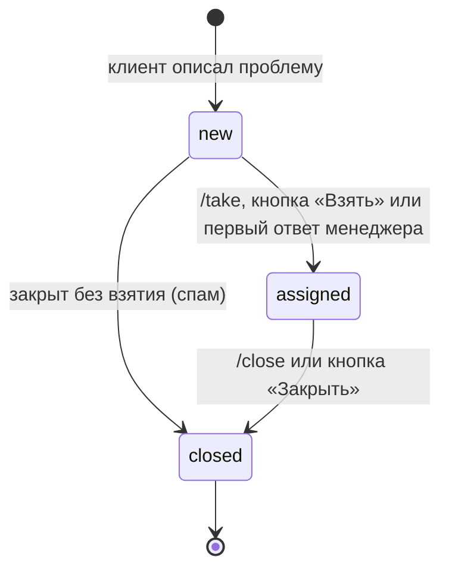

# Устройство

## 1. Слои

```
Telegram
   │
   ▼
middleware (update): контекст лога → перезагрузка конфига → сессия БД
   │
   ▼
router: менеджерские команды → клиентский сценарий (личка)
   │
   ▼
handler ── решает, что ответить, и разбирает объекты aiogram
   │
   ▼
service ── бизнес-логика тикетов и рассылка уведомлений
   │
   ▼
repository ── SQL, и ничего кроме SQL
```

Правило простое: **слои не перепрыгиваются**. Хендлер не ходит в базу
напрямую, сервис не знает про aiogram-фильтры, репозиторий не отправляет
сообщений. Отсюда — то, что логику тикета можно проверить без Telegram
(`tests/test_tickets.py`), а маршрутизацию без бизнес-логики
(`tests/test_wiring.py`).

Клавиатуры — примета слоя `bot`, и видно это на карточке тикета: сервис
отправляет её, но кнопки собирает `bot`, передавая фабрику «id тикета →
клавиатура». Готовую клавиатуру передать нельзя — id появляется только
внутри сервиса, после вставки в базу.

Почему сервис, а не «хендлер и так справится»: уведомление клиенту и запись
в базу — одна операция с точки зрения смысла. Разложи их по хендлерам, и
«взять тикет из /take» и «взять тикет кнопкой» однажды разойдутся в мелочах:
один уведомит клиента, другой нет.

## 2. Порядок middlewares

| Порядок | Middleware | Зачем именно здесь |
|---|---|---|
| 1 | `LoggingContextMiddleware` | `chat_id`/`telegram_user_id` в каждой строке лога, включая строки упавшего хендлера |
| 2 | `ConfigReloadMiddleware` | правка конфига должна примениться к ТОМУ ЖЕ апдейту; своей транзакции не имеет |
| 3 | `DbSessionMiddleware` | сессия на апдейт; транзакцию открывает сервис, а не middleware |

Перезагрузка конфига стоит до сессии намеренно: список менеджеров меняют
часто, и человек, которому права только что выдали, должен получить их своим
же сообщением — иначе он видит тишину и идёт искать несуществующую поломку.

## 3. Схема базы

```
support.tickets
  id, telegram_user_id, telegram_username, category, description,
  state (new|assigned|closed), manager_id,
  created_at, assigned_at, closed_at          все моменты — timestamptz

support.message_history
  id, ticket_id → tickets(id) on delete cascade,
  from_user_id, message_text, sent_at

support.message_routes
  (chat_id, message_id) PK, ticket_id → tickets(id) on delete cascade, created_at
```

Миграции — источник правды; модели (`app/db/models.py`) — её отражение, за
соответствием следит `tests/test_schema.py::test_models_match_database`.
`Base.metadata.create_all()` не вызывается нигде.

### Зачем `message_routes`

Telegram в апдейте на reply отдаёт только `message_id` сообщения, на которое
ответили. Ответить клиенту менеджер может и на карточку тикета, и на
пересланное сообщение клиента — значит, «какое сообщение бота к какому тикету
относится» где-то должно быть записано. Запись делается ровно там, где бот
что-то отправил (`TicketService._send_card_to_managers`,
`relay_from_client`, `_notify_client`).

Альтернатива — зашивать номер тикета в текст и парсить его — ломается на
первом же сообщении клиента, содержащем «№123».

### Ограничения целостности

- `tickets_state_valid` — состояние только из трёх известных;
- `tickets_assigned_requires_manager` — у `assigned` всегда есть ведущий;
- `tickets_closed_requires_manager` — у `closed` всегда есть тот, кто закрыл.

Последнее условие намеренно про `manager_id`, а не про `assigned_at`:
спам-обращение закрывают, не беря в работу, и требовать ради этого лишний шаг
«сначала возьми» — работа на пустом месте.

## 4. Жизненный цикл тикета



Ответ на `new`-тикет сразу переводит его в `assigned` с отвечающим как
ведущим: отдельное «сначала возьми, потом отвечай» — лишний шаг между
менеджером и клиентом.

## 5. Формат callback_data

Живёт целиком в `app/bot/callbacks.py`: и сборка, и разбор. Формат:

```
cat:<key>            клиент выбрал категорию
tk:take:<id>         менеджер берёт тикет
tk:close:<id>        менеджер закрывает тикет
```

Почему в одном файле: половина формата в клавиатуре и половина в хендлере
однажды разъезжаются — добавили кнопку, забыли разбор, нажатие тихо ничего
не делает. `parse` возвращает `None` на всё, что под формат не подходит;
фильтр `callbacks.Callback(...)` не пускает такое нажатие до хендлера.

## 6. Уведомления: что и когда

| Событие | Кому | Что |
|---|---|---|
| Тикет создан | чат менеджеров | карточка с кнопками |
| Взят в работу | клиенту | «вопрос №N взял менеджер» |
| Ответ менеджера | клиенту | текст ответа |
| Сообщение клиента | чат менеджеров | номер тикета, отправитель, текст |
| Тикет закрыт | клиенту | «вопрос №N закрыт» |

Недоступный получатель — не повод потерять событие: сообщение остаётся в
`message_history`, а отказ виден менеджеру в ответе на его действие.

## 7. Отказы на старте

Точка входа различает причины кодами выхода, чтобы в systemd сразу было
видно, что чинить:

| Код | Причина |
|---|---|
| 2 | конфиг или секреты невалидны (`ConfigError` с перечислением полей) |
| 3 | база недоступна по `DATABASE_URL` |
| 4 | `BOT_TOKEN` не принят: форма строки или отказ Telegram |

База проверяется ДО токена: `select 1` проходит у любой роли с правом
подключения и ничего не говорит про доступ к схеме, поэтому «база отвечает»
пишется в лог отдельной строкой, до `get_me`.

## 8. Тесты

| Файл | Что держит |
|---|---|
| `tests/test_config.py` | валидация конфига, горячая перезагрузка, сверка боевого файла с эталоном |
| `tests/test_callbacks.py` | сборка и разбор `callback_data`, отклонение мусора |
| `tests/test_tickets.py` | жизненный цикл тикета на живой базе |
| `tests/test_handlers.py` | хендлеры с настоящим FSM |
| `tests/test_wiring.py` | маршрутизация через настоящий `feed_update` |
| `tests/test_schema.py` | миграции, изоляция от `public`, соответствие моделей |

Интеграционные тесты требуют `TEST_DATABASE_URL` и без него пропускаются:
локально базы может не быть, в CI она поднимается сервисом.

Диспетчер в `test_wiring.py` собирается **один раз на модуль**: роутеры
aiogram — объекты уровня модуля, и `include_router` привязывает их к родителю
навсегда. Это идиома aiogram, а не наша особенность.
